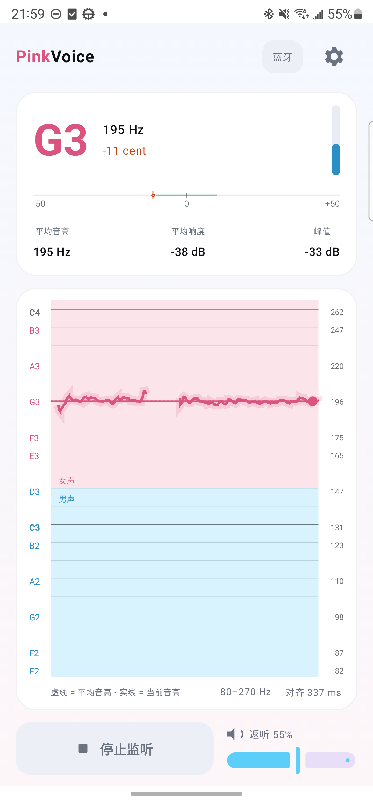
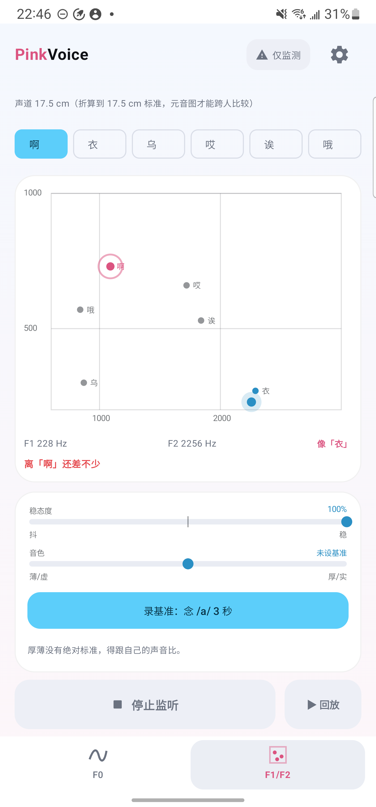
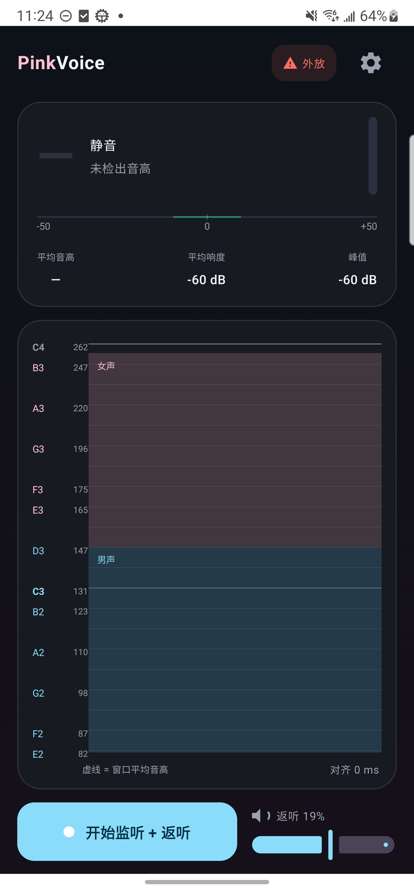
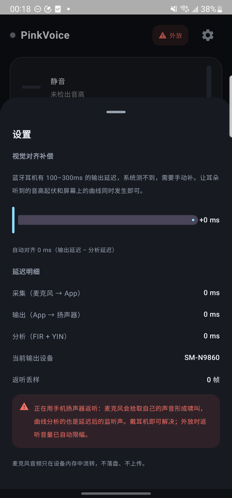

<div align="center">
  

  <h1>PinkVoice</h1>
  <p><b>边唱边看自己的音高曲线，同时在耳机里听到自己的声音。</b></p>
  <p>跨性别声音训练用的实时音高（F0）监测 + 同步返听 App</p>

  <p>
    <a href="https://github.com/vera-qwang/pinkvoice/actions/workflows/build.yml"></a>
    <a href="LICENSE"></a>
    
    
  </p>
</div>

---

| 特性 | 说明 |
|---|---|
| 实时 F0 曲线 | 对数频率轴，半音辅助线，标注男声区 / 女声区参考音域带 |
| 共振峰目标区 | 目标是一片**区域**不是一点 —— 告诉你 F1/F2 往前、往上抬了多少，差多少、往哪调 |
| 元音身份 | 实时认出你在发哪个元音，和女性化目标分开显示，不混淆 |
| 元音稳态训练 | 选一个目标元音，把它稳稳保持在目标区里，计时 |
| 音色轴 | 薄虚 ↔ 厚实，用你自己的声音作基准（录一段 /a/ 即可） |
| 底部导航 | F0 / F1/F2 两个页面，随时切换 |
| 音分指针表 | ±50 cent 偏差一眼可见，绿色为唱准区 |
| 窗口统计 | 平均音高（音名 + 频率，曲线上有参考线）、平均响度与峰值 |
| 同步返听 | 与分析并行，延迟 30–80 ms |
| 延迟自动测量 | `AudioTimestamp` 测采集与输出延迟，视觉自动对齐 |
| 蓝牙校准 | 蓝牙那段系统测不到的延迟，提供手动补偿滑块 |
| 频率范围可调 | 在曲线上上下滑动平移、双指捏合缩放，想看哪段频率看哪段 |
| 返听降噪 | 噪声门 + 高通，压掉返听里的环境底噪，不影响音高分析 |
| 无耳机自动降级 | 没接耳机时自动关闭返听，只做音高监测 |
| 外观 | 浅色 / 深色 / 跟随系统，随时切换 |
| 无网络权限 | 音频只在设备内存里流转，不落盘、不上传 |
| 无广告 | 不接广告 SDK，无横幅 / 插屏 / 开屏，不做任何行为定向 |
| 无账号无内购 | 装了直接用，不需要注册，也没有付费墙 |

<div align="center">
  
  
  
</div>

<p align="center"><sub>F0 曲线 · 元音图 · 浅色 / 深色 / 跟随系统三档外观</sub></p>

<div align="center">
  
</div>

<p align="center"><sub>延迟测量与对齐补偿 · 蓝牙设备自动识别 · 实时插拔耳机</sub></p>

## 下载

**[⬇ 下载 APK](https://github.com/vera-qwang/pinkvoice/releases/latest)**

去 [Releases](https://github.com/vera-qwang/pinkvoice/releases) 页面下载最新的
`pinkvoice-<版本>.apk` 就行。也可以直接点上面的按钮。

- 需要 Android 8.0（API 26）及以上
- 首次安装要在系统里允许「安装未知来源应用」
- 正式版用项目自己的密钥签名（`CN=PinkVoice`），**升级时请用同一个来源的 APK**——
  换了签名系统就不让覆盖安装，只能卸载重装（App 数据会丢）

自己构建的话，[Actions](https://github.com/vera-qwang/pinkvoice/actions) 里
每次提交的 APK 也作为 artifact 保留着。

## 快速开始

```bash
git clone https://github.com/vera-qwang/pinkvoice.git
cd pinkvoice
./gradlew :app:assembleDebug
adb install -r app/build/outputs/apk/debug/app-debug.apk
```

需要 JDK 17+ 与 Android SDK（compileSdk 36）。`local.properties` 已被 gitignore
（里面是本机的 SDK 路径），用 Android Studio 打开会自动生成；
命令行环境请自行写入 `sdk.dir=/path/to/android/sdk` 或设置 `ANDROID_HOME`。

装好后授予麦克风权限，点「开始监听 + 返听」即可。

## 使用指南

**1. 戴耳机。** 没接耳机时 App 会自动关闭返听、只做音高监测（顶部显示"仅监测"）。
原因很直接：手机扬声器会把麦克风的声音再播回来，形成啸叫，而且分析到的
也是被延迟污染的声音。接上耳机或蓝牙耳机后自动恢复返听。

**2. 看音分指针表。** 中心是 0（唱准），绿色区间 ±10 cent，黄色到 25 cent，
再往外是红的。指针比数字有用——数字只说差多少，指针说该往哪调。

**3. 蓝牙耳机需要校准对齐。** 打开设置面板（右上角齿轮），唱一个持续长音，
慢慢唱一串音阶，拖动「视觉对齐补偿」滑块，直到**耳朵听到的音高起伏**和
**屏幕上曲线的起伏**同时发生。有线或 USB-C 耳机不需要这一步。

**4. 对照音域色带。** 背景按 **164.8 Hz（E3）** 分界：下面是**蓝色 = 男声区**，
上面是**粉色 = 女声区**。同一个人唱同一个音，应该稳定落在同一侧。

**5. 调频率范围。** 默认看的是 80–270 Hz（男声区 + 女声区）。
在曲线上**上下滑动**平移（内容跟着手指走：往上滑看低处，往下滑看高处），
**双指捏合**缩放。右下角显示当前范围，点一下复位。

**6. 降噪（可选）。** 设置面板里有「降噪」滑块，压掉返听里的环境底噪
（空调、远处说话、风扇）。**只影响耳朵里听到的**——曲线和读数仍然是
真实的声音，所以降噪不会让轻声唱的音高丢失。嫌吵就往右拖，
环境本来就安静就关着。

**7. 换外观。** 设置面板顶部可切「跟随系统 / 浅色 / 深色」，立即生效。

## 隐私

麦克风音频**只在设备内存里流转**：返听走环形缓冲，分析走 16 kHz 降采样缓冲，
**不落盘、不上传**。

- 除 `RECORD_AUDIO` 外不申请任何权限
- **没有 `INTERNET` 权限**——App 在系统层面就不可能联网
- 所有分析都在本机完成
- **没有广告**：不接广告 SDK，不展示横幅/插屏/开屏，不做任何行为定向
- **没有内购、没有订阅、没有账号**——装了就是装了，不需要注册，也不会有付费墙

这些不是承诺，你可以直接打开 `app/src/main/AndroidManifest.xml` 核实每一条。
把源码摊开，是让"不收集数据"这件事可被验证，而不只是可被相信。

## 已知限制

| 限制 | 说明 |
|---|---|
| 蓝牙延迟 ~390 ms | 物理限制，消不掉。Note 20 Ultra + Galaxy Buds Pro 实测输出延迟 378–410 ms。用有线或 USB-C 耳机练实时音准效果最好 |
| 没接耳机时没有返听 | 手机扬声器会形成正反馈啸叫，所以没接耳机时直接不返听 |
| 只测音高，不测音色 | 判断"听起来像不像"需要共振峰分析（计划中） |
| 息屏会停止 | 需要前台服务才能后台继续（计划中） |

## 参与贡献

- [贡献指南](CONTRIBUTING.md) —— 环境、构建、PR 流程、代码约定
- [技术细节与真机踩坑](docs/technical-notes.md) —— 实现说明、问题记录、算法参数
- [设计规范](docs/design-spec.md) —— 配色、排版、布局、组件、图标

功能想法、bug 报告、真机数据都欢迎提。

### 路线图

已完成：实时 F0 曲线、音名/cents 读数、音分指针表、电平表、男/女声音域色带、
同步返听、延迟测量与自动+手动对齐补偿、蓝牙设备识别、无耳机时自动关闭返听、
频率范围滑动缩放、返听降噪、AGC/NS 关闭以保证分析精度、八度误判修正。

按价值排序的下一步：

1. **共振峰分析**（LPC + Levinson-Durbin 求 F1/F2/F3）→ 判断"说话声 vs 唱歌声"、
   听感性别的关键（`F1/f0` 比值）；比音高更能反映音色是否到位；
2. **颤音检测**：f0 曲线的 4–7 Hz 周期与幅度（cents）；
3. **音域测试**：跟随长音测最高/最低音，评估换声点；
4. **实时音高校正播放**（Auto-Tune）：需要做 formant correction；
5. **录音回放对比**；
6. **前台服务 + 息屏继续测量**。

### 为什么开源

这个 App 服务的是一群长期缺少工具支持的人。把它开源，意味着：

- 任何人都可以**审计**它到底有没有偷偷录音、上传数据——而不只是相信一句承诺；
- 社区可以自己加功能（FTM 方向的音域训练、颤音检测、共振峰分析……）；
- 不用担心某家公司把它买走，或者停止维护。

开源也让"没有广告"这件事**永久成立**：只要 App 里不接广告 SDK、
不申请 `INTERNET` 权限，就永远不会有第三方代码把你的音频
（或者任何别的数据）发出去。装机量再大也不会有人有动机去加它——
因为一加，它就不再是这个项目了。

## 许可

代码采用 [Apache License 2.0](LICENSE)。

图标、配色等视觉资产同样以 Apache-2.0 释出。
