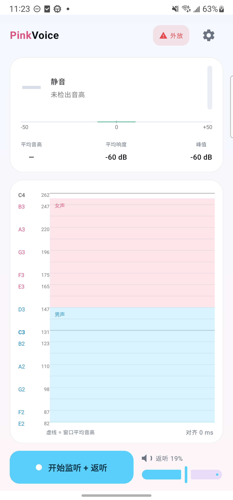
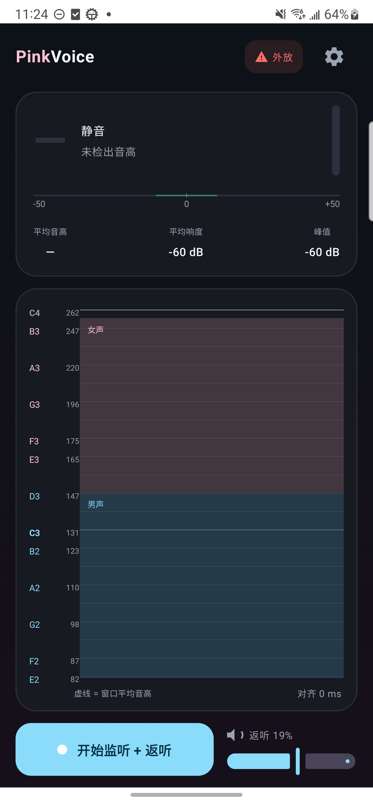

# 设计规范

PinkVoice 的视觉与交互规范。记录当前实现里**实际生效**的值——
改 UI 时对照这份文档，改完也回来更新它。

实现位置：`app/src/main/java/com/vera/pinkvoice/ui/`
（`Theme.kt` 定义全部色板与字号常量，`Components.kt` 是可复用组件，
`PitchCurve.kt` 是曲线 Canvas，`VoiceScreen.kt` 负责页面布局）

---

## 1. 配色

### 品牌色分两档

取自跨性别旗：浅蓝 + 粉 + 白。逐像素取样自原始 logo。

**填充档**——用于大面积色块（按钮、芯片、色带背景）：

| 名称 | 色值 | 用途 |
|---|---|---|
| `BrandBlue` | `#5CCEFA` | 主色（浅色主题）、男声区色带 |
| `BrandBlueSoft` | `#8BDCFB` | 主色（深色主题）、电平表填充 |
| `BrandPink` | `#F5A8B8` | 辅色、女声区色带 |
| `BrandPinkSoft` | `#FFC2D3` | 辅色（深色主题）、曲线轨迹 |
| `InkOnBrand` | `#063043` | **品牌浅色上的文字色**（见下方对比度） |

**描边档**——用于浅色背景上的细线和小字：

| 名称 | 色值 | 白底对比度 |
|---|---|---|
| `BrandBlueInk` | `#2A8FC4` | 3.61:1 ✅ |
| `BrandPinkInk` | `#DB5480` | 3.76:1 ✅ |

> 为什么要分两档：品牌浅色本身在白底上只有 **1.8:1**，
> 拿它画 2.6 dp 的曲线描边几乎看不见（WCAG 对图形元素要求 ≥3:1）。
> 所以描边档取同色系更深的一档，品牌感不变，可见度达标。

> 跨性别旗是跨性别社群共同创造的符号，本项目使用它的配色是致敬，不是占有。

### 对比度：品牌浅色上不能用白字

| 前景 / 背景 | 对比度 | WCAG AA 正文（4.5:1） |
|---|---|---|
| 白字 / `#5CCEFA` | **1.8:1** | ❌ 不合格 |
| `InkOnBrand` `#063043` / `#5CCEFA` | **7.7:1** | ✅ 合格 |
| 白字 / `#F5A8B8` | **1.9:1** | ❌ 不合格 |
| `InkOnBrand` `#063043` / `#F5A8B8` | **7.4:1** | ✅ 合格 |

所以主色按钮是**浅蓝底 + 深墨蓝字**，不是白字。这条不能改回去。

深色主题下品牌浅色在深底上有 11:1 以上的对比度，直接用浅色档即可。

### 声学语义色（`VoicePalette`）

这些色只在 Canvas 里用（音分指针表、曲线色带、电平表），
深浅主题取值不同，所以单独抽成一个 data class，
不塞进 Material 的 `ColorScheme`。

| 角色 | 浅色 | 深色 | 含义 | 白底对比度 |
|---|---|---|---|---|
| `maleBand` | `#5CCEFA` @24% | `#5CCEFA` @18% | 男声参考区背景 | — |
| `femaleBand` | `#F5A8B8` @30% | `#F5A8B8` @20% | 女声参考区背景 | — |
| `trace` | `#DB5480` | `#FFC2D3` | 曲线轨迹 | 3.76:1 ✅ |
| `primaryInk` | `#2A8FC4` | `#8BDCFB` | 当前音高指示（虚线 + 圆点） | 3.61:1 ✅ |
| `grid` | `#0F1115` @8% | `#FFFFFF` @10% | 网格线 | 装饰性 |
| `axisLabel` | `#11161C` @62% | `#FFFFFF` @55% | 坐标轴与刻度文字 | 4.75:1 ✅ |
| `inTune` | `#0E9F5E` | `#32D583` | 唱准（\|Δ\| ≤ 10 cent） | 3.42:1 ✅ |
| `nearTune` | `#C2410C` | `#FDB022` | 接近（≤ 25 cent） | 5.14:1 ✅ |
| `offTune` | `#E5484D` | `#F97066` | 偏离（> 25 cent）、过载 | 3.91:1 ✅ |
| `meterTrack` | `#E9ECF3` | `#2A3040` | 电平表轨道 | — |
| `meterFill` | `#2A8FC4` | `#8BDCFB` | 电平表填充 | 3.61:1 ✅ |
| `needleInner` | `#FFFFFF` | `#0E1014` | 指针中心点 | — |
| `cardBorder` | `#0F1115` @6% | `#FFFFFF` @10% | 卡片描边 | 装饰性 |
| `backgroundTop` | `#F4F8FE` | `#0D1118` | 页面背景渐变上色 | — |
| `backgroundBottom` | `#FDF6F9` | `#16101A` | 页面背景渐变下色 | — |

**音准三档是语义固定色，不随主题换色相**——绿/黄/红在两个主题里含义一致，
只是亮度适配背景。

浅色主题的语义色都按 WCAG 校过：曲线描边、电平表、当前音高指示原本直接用品牌浅色
（1.8:1，细线几乎看不见），坐标轴文字只有 2.56:1（10 sp 的刻度太淡），
现已全部提到 3:1 / 4.5:1 以上。

### Material 色板

| 角色 | 浅色 | 深色 |
|---|---|---|
| `primary` / `onPrimary` | `#5CCEFA` / `#063043` | `#8BDCFB` / `#063043` |
| `secondary` / `onSecondary` | `#F5A8B8` / `#063043` | `#FFC2D3` / `#4A1226` |
| `background` | `#F7F8FB` | `#0E1014` |
| `surface` | `#FFFFFF` | `#171A21` |
| `surfaceVariant` | `#EDEFF6` | `#222732` |
| `outline` | `#D9DDE7` | `#2C313C` |
| `error` | `#E5484D` | `#F97066` |

---

## 2. 排版

| 用途 | 字号 | 字重 |
|---|---|---|
| 读数卡音名（A3 / A4） | 50 sp | Bold |
| 标题（Voice Tools / PinkVoice） | 19 sp | Bold |
| 主按钮文字 | 16 sp | — |
| Hz 与音分读数 | 14 sp | — |
| 芯片文字（⚠ 仅监测） | 12 sp | — |
| 次要说明 | 12–13 sp | — |
| 刻度、坐标轴、色带标签 | 10–11 sp | — |

音名用 50 sp 是有意的：它是这个 App 的主视觉，读数必须一眼可辨。

---

## 3. 布局

### 页面结构（自上而下）

```
状态条（44 dp）      状态点 + 标题 + 输出设备芯片 + 设置图标
读数卡                音名 + Hz + 音分 + 指针表 + 电平柱
曲线卡（weight 1f）    实时音高轨迹
控制条                开始/停止（54 dp 高）+ 返听音量
```

- 页面外边距：水平 16 dp，上 10 dp，下 12 dp
- 卡片间距：12 dp
- 卡片圆角：22 dp
- 芯片圆角：22 dp
- 主按钮圆角：16 dp
- **必须加 `WindowInsets.safeDrawing`**，否则底部控件会被系统导航条压住

### 曲线卡

| 参数 | 值 |
|---|---|
| 频率轴 | 对数，默认 80–270 Hz，可滑动平移 / 双指缩放（40–1000 Hz） |
| 时间窗 | 6000 ms |
| 左侧音名列 | 22 dp（音名，如 "C4"） |
| 右侧频率列 | 26 dp（频率，如 "262"） |
| 底部信息条 | 图例 / 频率范围芯片 / 对齐值，一行并排 |
| 男声区色带 | 164.81 Hz 以下整片（蓝） |
| 女声区色带 | 164.81 Hz 以上整片（粉） |
| 平均音高参考线 | 按所在音域着色，虚线，55% 不透明度 |
| 轨迹描边 | 9 dp（底层）+ 2.6 dp 辉光（顶层） |
| 当前音高指示 | 实线 + 半径 5 dp 圆点，按所在音域着色 |
| 网格线 | 半音一条，八度线加粗到 1.4 dp |
| 底部内边距 | 34 dp（给坐标轴标签留位） |

**频率轴范围**：默认 80–270 Hz，用户可以在曲线上**上下滑动**平移、
**双指捏合**缩放（40–1000 Hz）。范围存在 `mutableFloatStateOf` 里，
**在绘制时读取**——滑动只重画画布，不触发重组。

**色带是无限延伸的**：164.81 Hz（E3）以下整片男声区浅蓝，以上整片女声区浅粉。
早先色带是有限区间（82–147 / 147–255），滑到 255 Hz 以上时两个色带
都在视野外，整个绘图区变成一片空白——看着像坏了。现在色带只回答
"这里是男声还是女声"，不会因为滑动而失效。

滑动方向按**内容跟着手指走**：往上滑 → 曲线往上移 → 看到更低的频率。
和滚动文档、看地图的直觉一致。

### 控制条

| 元素 | 尺寸 |
|---|---|
| 开始/停止按钮 | 高 54 dp，`weight(1f)` |
| 返听音量组 | 宽 136 dp |
| 音量滑块 | 高 28 dp |

---

## 4. 组件

### 音分指针表（`CentsGauge`）

高 34 dp，量程 ±50 cent，轴线在高度的 42% 处。

- 轨道：圆角 3 dp，高 6 dp
- 唱准区：±10 cent，`inTune` @50% 透明度
- 中心刻度：竖线，上下各 9 dp
- 指针：半透明竖线（7 dp 宽，上下各 16 dp）+ 圆点（半径 7 dp）+ 中心白点（半径 2.6 dp）
- 指针颜色：\|Δ\| ≤ 10 → 绿；≤ 25 → 黄；否则红
- 刻度文字 `-50` / `0` / `+50`，10 sp，**用 `textMeasurer.measure()` 测量后定位**，
  否则右侧 "+50" 会被裁掉

### 电平表（`LevelMeter`）

宽 8 dp，高 72 dp。竖直填充。
颜色：正常 `meterFill`，**过载转 `offTune`（红）**。

### 状态点（`StatusDot`）

直径 10 dp。外圈 `Color.White` @35% 做柔边。
运行中用 `inTune`（绿），停止用 `outline`（灰）。

### 输出设备芯片

圆角 22 dp，内边距水平 18 dp、垂直 14 dp，文字 12 sp。

- 蓝牙 / 有线：普通样式
- **⚠ 仅监测**：中性色 + "⚠ 仅监测"文案。这是状态不是错误——
  没接耳机时返听已经关掉了，用红色会让人以为出了故障

---

## 5. 图标

### 造型

5 根等宽胶囊，**底部齐平**，高度即音高轮廓。前二蓝、后三粉。

| 参数 | 值（108 画布） |
|---|---|
| 柱宽 | 8 dp |
| 柱间距 | 4.5 dp |
| 图形总宽 | 58 dp |
| 基线 | y = 70 |
| 柱高 | 20 / 30 / 36 / 24 / 28 |

**最高的柱放在中间**，这样外侧两根足够短，圆形遮罩下不会切角。

### 自适应图标

- 前景层：`drawable/ic_launcher_foreground.xml`
- 单色层：`drawable/ic_launcher_monochrome.xml`（Android 13+ 主题图标）
- 背景：`#FFFFFF`
- **图形必须收在中心 66 dp 安全圆内**（两侧各留 25 dp）
  ——108 画布的外侧 18 dp 是留给遮罩与视差效果的，不能放内容

### 渲染规则

按 Android 自适应图标的真实规则渲染时（108 画布 → 72 可见区）：

```
缩放 1.5×，偏移 -0.25 × 边长
```

---

## 6. 主题模式

设置面板顶部有「外观」三档：`跟随系统` / `浅色` / `深色`。

| 浅色 | 深色 |
|---|---|
|  |  |


- 枚举定义在 `ui/Theme.kt` 的 `ThemeMode`，显示名在 `ui/VoiceScreen.kt` 的
  `displayName` 扩展属性
- 持久化：`Prefs`（`SharedPreferences`，键 `theme_mode`），只存 `storageKey` 字符串
- 状态提升到 `MainActivity`：`PinkVoiceTheme(darkTheme = ...)` 决定用哪套色板
- 切换立即生效，不需要重启
- **跟随系统**时监听 `isSystemInDarkTheme()`，系统切换深浅色会实时跟随
- 强制档不受系统设置影响，重启 App 后仍保持

控件用 Material 3 的 `SingleChoiceSegmentedButtonRow`，
选中态容器色设为 `primary`（品牌浅蓝）、文字色 `onPrimary`（深墨蓝）。

## 7. 交互约定

- **调参项不进主界面**。对齐补偿、延迟明细、未接耳机提示全收进底部 `ModalBottomSheet`
- **状态点与设备芯片常驻**，让用户随时知道"现在在监听吗、声音从哪出来"
- **频率范围可调**。曲线上上下滑动平移、双指捏合缩放。范围存成
  `mutableFloatStateOf` 并**在绘制时读取**——滑动只重画画布，不触发重组
  （整屏重组是之前 CPU 的大头）。方向按数值轴的直觉来：**往上滑 = 看更高频率**。
- **没接耳机就完全不返听**，不要靠限幅止损。手机扬声器返听会形成正反馈啸叫，
  且曲线分析到的是延迟后的监听声——限幅到 35% 也救不了"分析的不是人声"这件事。
  顶部芯片显示「⚠ 仅监测」、音量滑块置灰、按钮文案改成「开始监听」，
  接上耳机自动恢复
- **曲线区不做纵向自动缩放**。默认 80–270 Hz 对数轴，
  这样不同人之间的曲线可以直接对比。用户可以自己上下滑动平移、
  双指捏合缩放（40–1000 Hz）——但那是用户的主动选择，
  不是 App 根据检测到的音高自动缩放
- **坐标栏要给足信息**。音名 + 频率两列：音名按所在音域着色
  （女声区粉色、男声区蓝色、其余中性灰），频率右对齐——
  粉色区域里粉色的音名，一眼就知道自己落在哪个音域
- **半音一条辅助线，强度只有两档**。八度线 55% 透明度、半音线 18%，
  八度线另外加粗到 1.4 dp。色带是整片铺满的，所以没有"带内 / 带外"
  的区别——早先分了两档（八度线 1.0 vs 0.55、半音线 0.45 vs 0.18），
  滑到色带边界外时整片网格会突然变亮，看着像有一道白线
- **网格色必须是不透明的**，强度完全由绘制时的 alpha 控制。
  早先 grid 色自带 8% 黑 / 10% 白，绘制时又用 `copy(alpha = ...)` 调，
  结果那个自带 alpha 被整个替换掉——深色主题的八度线成了 100% 纯白，
  浅色主题成了 100% 纯黑
- **八度误判要挡在曲线之外**。YIN 会时不时把 f0 报成 f0/2 或 2×f0，
  而且常常连续好几帧、清晰度还不低（0.57~0.86），看着像是真的。
  真机录了 11 万帧数据，八度误判的持续长度分布是 3 / 4 / 4 / 6 / 7 / 8 帧。
  固定 3 帧的迟滞挡不住——第三帧一到稳定值就整个跳到低八度，
  曲线出现一个又深又窄的倒钩。现在**跳变越大要的确认帧数越多**
  （≤400 cent 要 3 帧，400~700 cent 要 6 帧，>700 cent 要 10 帧），
  11 万帧里八度级跳变从 7 次降到 0 次。滑音每步只走几十 cent，
  走第一步就被直接跟上了，完全不受影响。
- **起音也要 3 帧才认**。真机数据里栽过：唱到 157 Hz，起音那两帧
  YIN 给的是 75.1 / 75.7 Hz（低八度），两帧一致就把稳定值定在了低八度。
- **返听降噪只加在返听通路**，分析支路保持原样。门限一刀切下去会把
  轻声唱也切掉，曲线会断成一段段。曲线和读数永远反映真实的声音。
- **两个参考音域不能重叠**。原先男声 85–180、女声 165–255 重叠 165–180，
  画色带时蓝粉混在一起，音名着色也因为"先判男声区"而把明明在粉色带上的
  F3（175 Hz）显示成蓝色。现在以 164.81 Hz（E3）为界，两区不重叠
- **分界点定在 E3（164.81 Hz）**。早先按"对数轴视觉平衡"取几何中点
  √(85×255) ≈ 147 Hz（D3），两区在对数轴上差不多大（48% vs 45%）。
  但实际用下来，男声的音域比按几何中点算的要高——变声期往上走之后，
  基频落在 D3 附近的男声不多，分界偏低会让蓝区显得"总是偏大"。
  抬到 E3 更贴合实际音高分布。代价是蓝色块占 62%、粉色占 38%，
  不再对称——但女声区的音高本来就集中在 165–255 这一段，视觉上不亏。
  E3 正好是整音，音名标注不会出现"跳变"式的错位
- **窗口统计放读数卡，不放曲线卡**。读数卡底部一行三格：
  平均音高 / 平均响度 / 峰值——都是"这段时间的整体情况"，放一起读是一组指标。
  曲线上那条蓝色虚线是平均音高的图形表示，卡片底部给出图例
- **坐标栏的两列要紧凑**。音名靠左、频率右对齐到曲线区边缘，
  中间不刻意留空隙——否则读起来是"一个数 + 一大片空白 + 一个数"
- **标题 "Pink" 用品牌粉**。左上角的标题分两段渲染：
  "Pink" 用描边档品牌粉，"Voice" 保持中性色。用富文本（buildAnnotatedString）
  而不是两个 Text，否则两段的基线会差一点点
- **大音名按音域着色**。读数卡左上角那个 50 sp 的音名，
  唱到女声区显示粉色、在男声区显示蓝色、两个音域之外是中性灰。
  判定用和坐标轴刻度同一个 `bandColorOf()`，两处颜色永远对得上


---

## 8. 改 UI 时的检查清单

- [ ] 深浅两个主题都看过，三档外观模式都试一遍
- [ ] 新加的颜色先算对比度（正文 ≥4.5:1，图形元素 ≥3:1）
- [ ] 加了新颜色先算对比度，白字在 `#5CCEFA` 上不合格
- [ ] 新的 Canvas 元素不要在 `DrawScope` 里读 `CompositionLocal`，
      改成函数参数传进来
- [ ] 底部元素确认没被导航条压住
- [ ] 曲线上的文字先 `measure` 再定位
- [ ] 改完回来更新这份文档
